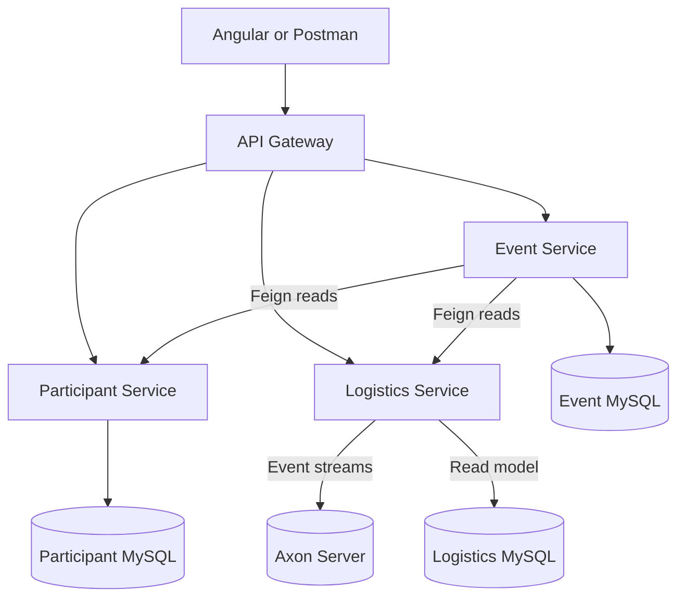

# FST Events Microservices

A local event-management application built with Spring Cloud and Angular for the *Architecture des composants* DS. An organizer can create an event, assign participants, reserve equipment and see the reserved logistics cost. The project migrates an existing Spring Boot monolith into three business services and demonstrates how a request behaves when one of them slows down or fails.

**The running example** is a conference with one organizer and four reserved chairs at 12.50 TND each. The event statistics should show **50 TND**. If Logistics becomes unavailable, the organizer count can still be returned. The cost becomes unknown, and the response includes a warning. This single example connects the business model, service calls, resilience policies and monitoring.

[Windows setup](docs/SETUP_WINDOWS.md) · [Live demonstration](docs/DEMO.md) · [Evaluation checklist](docs/EVALUATION.md) · [Recorded test results](docs/VALIDATION.md)

## Architecture and data ownership

The service boundaries follow three responsibilities. Participant manages people and their tasks, Logistics owns equipment and reservation rules, and Event owns the schedule and associations between them. Infrastructure services supply configuration, discovery and routing.



**How a statistics request travels.** Angular sends `GET /api/event-stats/{id}` to the Gateway. The Gateway removes the `/api` prefix and uses service discovery to route the request. Event loads the event and its associated IDs from its database, then uses OpenFeign to read participant and logistics details. It computes the reserved cost from price × quantity for each reserved resource. Spring Cloud LoadBalancer selects an available instance for calls made by service name.

**How the databases stay consistent.** Event stores external IDs and validates them when creating or updating an event. Each service commits changes to its own database. Deleting an event removes its local associations. Equipment keeps its own reservation state until explicitly released. Deleting a participant can leave a stale ID on an event, which the statistics API reports as incomplete. Cross-service cascade deletion and migration of old monolith records are outside the implemented flow.

### Repository map

| Module | Responsibility |
| --- | --- |
| config-server | Central YAML configuration, native backend mounted from this Git repository |
| eureka-server | Dynamic service discovery |
| api-gateway | Explicit API routes, service load balancing and restricted development CORS |
| participant-service | Participant CRUD and task enum; its own MySQL database |
| logistics-service | Axon commands/aggregate/events; MySQL query projection; its own MySQL database |
| event-service | Event CRUD, references by ID, Feign composition, statistics, resilience and optional cost job; its own MySQL database |
| shared-contracts | HTTP DTOs and shared input error handling; no shared JPA entities |
| frontend | Adapted Angular interface for event, participant and logistics operations |

| Supporting path | What to find there |
| --- | --- |
| `config-repo/` | Central service YAML. The resilience settings for this domain are in [event-service.yml](config-repo/event-service.yml). |
| `compose.yml`, `compose.*.yml` | Local topology, optional second participant instance and overrides for failure demonstrations. |
| `scripts/`, `postman/` | Startup, smoke, load-balancing and rate-limit checks, plus the importable API collection. |
| `ops/` | Shared service Dockerfile, Maven repository settings, Prometheus scrape job and Grafana dashboard. |
| `Jenkinsfile`, `.github/workflows/` | Local Jenkins delivery pipeline and GitHub Actions build checks. |
| `docs/` | Installation, demonstration, validation, evaluation and Git/Jira material. |

## Run locally on Windows

Use Docker Desktop with Linux containers and Docker Compose, JDK 17, Maven 3.9+, Node.js 22 and npm. The project uses Spring Boot 3.5.8, Spring Cloud 2025.0.1, Axon Framework 4.12.3 and Angular 18. The existing Jenkins, Nexus, SonarQube, Prometheus and Grafana containers share the external Docker network `devops`. On a fresh installation, create that network with `docker network create devops` before startup.

**1. Build and start the backend.** From the folder containing `compose.yml`, run PowerShell:

```powershell
powershell -ExecutionPolicy Bypass -File scripts/start.ps1
```

The script creates `.env` from the example on first use, verifies the Maven build and starts the containers. Keep this configuration local. The application has development CORS settings and no user authentication.

**2. Create the demonstration event.** Once the services have registered in Eureka, run:

```powershell
powershell -ExecutionPolicy Bypass -File scripts/smoke.ps1
```

Each run creates a new participant, resource and event. The script saves their IDs in `reports/demo-ids.json`. Read the exact event you just created:

```powershell
$demo = Get-Content reports/demo-ids.json | ConvertFrom-Json
Invoke-RestMethod "http://localhost:8090/api/event-stats/$($demo.eventId)"
```

Expected values include `nbParticipants = 1`, `coutLogistiqueReservee = 50` and `degraded = false`.

**3. Open the UI.** In a second terminal, from the repository root:

```powershell
cd frontend
npm ci
npm start
```

Open [Angular](http://localhost:4200). To stop the application containers and keep their volumes, run `docker compose stop` from the root. Press Ctrl+C in the Angular terminal to stop the UI.

## Logistics writes and reads with Axon

CQRS separates changing a resource from reading its current state. Logistics has an explicit lifecycle and a business rule that makes this separation visible.

| Step | What happens | Evidence |
| --- | --- | --- |
| Create | The controller sends a command. `LogisticsAggregate` validates the request and applies a `Created` event. | The command endpoint returns a 202 receipt containing `idLog`. |
| Project | An `@EventHandler` consumes the event and updates the logistics MySQL read model. | The resource appears in a query after projection completes. |
| Read | A query goes through Axon’s QueryGateway to an `@QueryHandler`. | Swagger or Angular displays the current quantity, price and reservation state. |
| Reserve or release | The aggregate checks the current reservation state and records an accepted transition. | Inspect the resource’s event history by aggregate ID in Axon Server. |
| Delete | The aggregate permits deletion after release. The projector removes the row when it processes `Deleted`. | The history remains visible in Axon and the resource disappears from the list. |

A reserved resource must be released before deletion. In Angular, choose **Modifier**, clear **Ressource réservée**, save and verify the row shows **Disponible**. The intended response for a business rejection is HTTP 409. A generic 503 was observed during a local deletion attempt. Verify this path against the running Axon stack during rehearsal.

## Resilience and the five failure scenarios

Event Service applies Resilience4j to dependency reads. Retry allows **three total attempts** with **500 ms** between attempts. Feign uses a **1 s connection timeout** and a **5 s read timeout per attempt**. Each dependency has a circuit breaker with a six-call window, a 50% failure threshold, a 10 s open period and two half-open probes. The statistics endpoints share a limit of **five requests per second per Event Service instance**.

| Demonstration | Change introduced | Evidence to inspect |
| --- | --- | --- |
| Service down | Stop Logistics. | Event statistics retain participant data and report missing logistics values. |
| Latency over 5 s | Enable the demo overlay and inject a 6 s delay. | A direct read is slow. The composing call times out, retries or reaches fallback according to breaker state. |
| Incorrect response | Inject an invalid payload with HTTP 200. | Event Service detects invalid data and adds a warning. |
| Bad URL | Apply the Event Service URL override. | A direct Logistics query succeeds while the composed request degrades. |
| Database unavailable | Stop logistics MySQL while Logistics runs. | The read-model query fails. After recovery, the same event should show 50 TND again. |

The walkthrough includes the injection and restoration steps for each case. The optional visual console, if installed in the project, starts with `demo-console/Lancer.cmd`. Select **Statistiques de l’événement** for a baseline, then **Service arrêté** to compare healthy, degraded and recovered responses. [Demo instructions](docs/DEMO.md)

For load balancing, run `scripts/load-balance.ps1` and observe two distinct response IDs behind the same Gateway URL. Both instances use the same participant database. For rate limiting, `scripts/rate-limit.ps1` sends concurrent requests so HTTP 429 responses can be observed. The optional scheduled cost job, enabled with `COST_JOB_ENABLED=true`, refreshes stored event costs when complete logistics data is available.

## Tools and what they demonstrate

| Tool | Why it is used here | Where to see it |
| --- | --- | --- |
| Spring Cloud Config and Eureka | Share service configuration and discover running service instances. | Config Server’s `/event-service/default` and the Eureka dashboard. |
| Gateway, OpenFeign and LoadBalancer | Route incoming requests and compose data across service boundaries by logical name. | Gateway statistics and the participant-instance endpoint. |
| Swagger UI and Postman | Explore each service’s contract and exercise requests through the Gateway. | Three Swagger UIs and the repository’s Postman collection. |
| Micrometer, Actuator and Prometheus | Instrument requests and resilience policies, expose the measurements and collect them over time. | `/actuator/prometheus` on each app and the Prometheus Targets page. |
| Grafana | Show how request rate, latency and circuit state change during a failure. | Import [the dashboard](ops/grafana/events-dashboard.json) and select the Prometheus data source. |
| Zipkin | Follow a single request across the Gateway, Event Service and its downstream calls. | Generate a stats request, then search recent traces for `event-service`. |
| Docker Compose | Run the services, Axon, Zipkin and three MySQL databases with reproducible network addresses. | [Compose configuration](compose.yml) and Docker Desktop. |
| Maven, JUnit and JaCoCo | Package the modules, check business rules and collect test coverage. | Maven test reports and the archived JaCoCo reports in Jenkins. |

## API reference

Use Gateway port **8090** for business requests. Event and participant IDs are numeric. Logistics IDs are UUID strings.

| API | Purpose |
| --- | --- |
| GET/POST /api/participants | List/create participants |
| GET/PUT/DELETE /api/participants/{id} | Participant CRUD |
| GET/POST /api/events | List/create events |
| GET/PUT/DELETE /api/events/{id} | Event CRUD, ID references |
| GET /api/event-stats?from=2027-01-01&to=2027-12-31 | Composed statistics |
| GET /api/event-stats/{id} | Composed event statistics |
| GET /api/event-stats/summary | Global statistics |
| POST /api/logistics/commands | Create resource (202 with idLog) |
| PUT /api/logistics/commands/{id} | Update resource |
| PUT /api/logistics/commands/{id}/reservation?reserved=true | Reserve/release |
| DELETE /api/logistics/commands/{id} | Delete an unreserved resource |
| GET /api/logistics/queries | List projected resources |
| GET /api/logistics/queries/{id} | Read a projected resource |
| GET /api/demo/participant-instance | Observe Gateway load balancing |

**Interactive documentation:** [Participant Swagger](http://localhost:8091/swagger-ui/index.html) · [Logistics Swagger](http://localhost:8092/swagger-ui/index.html) · [Event Swagger](http://localhost:8093/swagger-ui/index.html) · [Postman collection](postman/Events-Microservices.postman_collection.json)

## CI and artifact delivery

The [Jenkinsfile](Jenkinsfile) checks out the repository and builds the Maven modules on a Linux agent configured with Jenkins tools `jdk17` and `maven3`. Choose **Build with Parameters** to select the delivery stages.

| Parameter | Default | Outcome when enabled |
| --- | --- | --- |
| `RUN_SONAR` | On | SonarQube analyzes project `fst-events`. Maven waits for the Quality Gate before the pipeline proceeds. |
| `PUBLISH_NEXUS` | Off | Maven publishes versioned artifacts to Nexus. Look for `shared-contracts` under `maven-snapshots`. |
| `PUBLISH_DOCKERHUB` | Off | Jenkins builds six service images with `ops/Dockerfile` and pushes each as `<username>/fst-events-<service>:build-<number>-<commit>`. |

Configure Jenkins credentials `sonar-token` (secret text), `nexus-credentials` (username/password) and `dockerhub-credentials` (Docker Hub username/write token). Docker publishing requires Docker CLI and daemon access on the agent and internet access to Docker Hub. Runtime services and monitoring run locally. GitHub Actions separately verifies the backend and builds Angular.

## Local addresses

Use the host column from Windows and the Docker column from containers on `devops`. This matters when configuring Prometheus targets or connecting Grafana to Prometheus.

| Component | Host URL / port | Docker address on devops |
| --- | --- | --- |
| Existing Jenkins | http://localhost:8080 | jenkins:8080 |
| Existing Nexus | http://localhost:8081 | nexus:8081 |
| Existing SonarQube | http://localhost:9000 | sonarqube:9000 |
| Existing Grafana | http://localhost:3000 | grafana:3000 |
| Existing Prometheus | http://localhost:9090 | prometheus:9090 |
| Angular | http://localhost:4200 | Runs on Windows |
| Gateway | http://localhost:8090 | api-gateway:8080 |
| Participant | http://localhost:8091 | participant-service:8081 |
| Logistics | http://localhost:8092 | logistics-service:8082 |
| Event | http://localhost:8093 | event-service:8083 |
| Participant instance 2 | http://localhost:8094 | participant-service-2:8081 |
| Config Server | http://localhost:8888 | config-server:8888 |
| Eureka | http://localhost:8761 | eureka-server:8761 |
| Zipkin | http://localhost:9411 | zipkin:9411 |
| Axon Server | http://localhost:8024 ; gRPC 8124 | axonserver:8024 ; axonserver:8124 |
| Participant MySQL | 127.0.0.1:3307 | mysql-participant:3306 |
| Logistics MySQL | 127.0.0.1:3308 | mysql-logistics:3306 |
| Event MySQL | 127.0.0.1:3309 | mysql-event:3306 |

## Validation and evaluation

The recorded build passed **19 automated tests** and the Angular production build. Tests cover aggregate rules, the MySQL projector logic, statistics composition and resilience behavior. The Axon integration test used H2 and an in-memory event store. The recorded discovery test used two HTTP stubs. A full classroom demonstration also exercises real containers, database recovery, two participant instances, a Zipkin trace and publication from Jenkins. [Validation details](docs/VALIDATION.md)

The evaluation grid allocates **9 points** to implementation, **1** to the scenario, **3** to excellence, **5** to explaining the code and concepts, and **2** to Git/Jira. For a presentation, begin with the 50 TND event, interrupt Logistics, explain the partial response, then restore the service and show the same event recovering. Use the CQRS history and repository commits to connect the visible result to the code that produced it. [Evaluation checklist](docs/EVALUATION.md) · [GitHub handoff](docs/GITHUB.md) · [DevOps setup](docs/DEVOPS.md)
