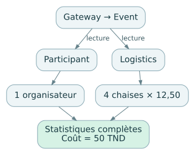
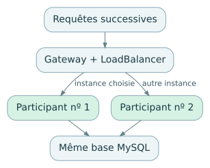
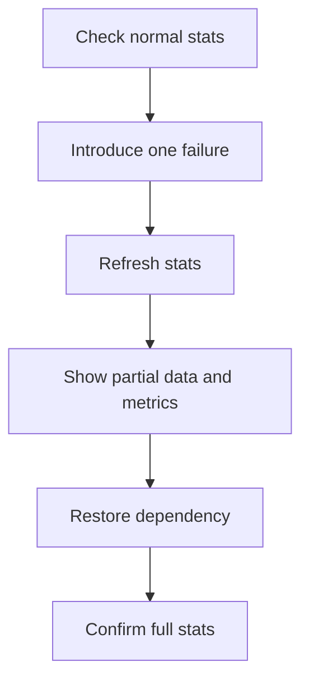
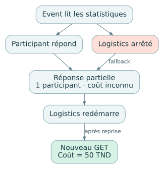
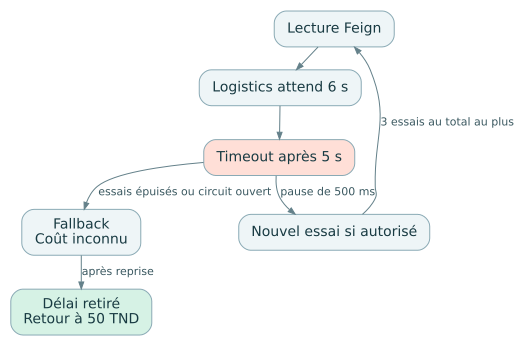
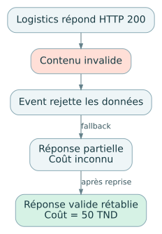
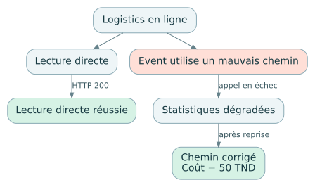
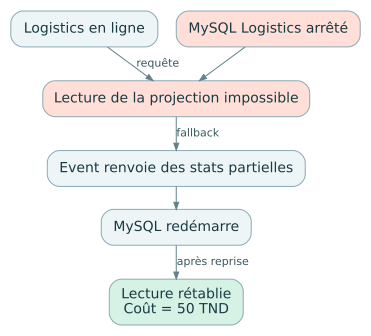
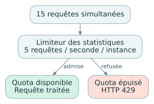
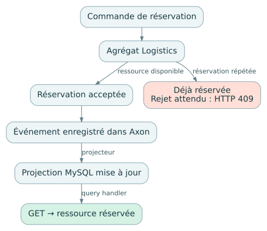

# FST Events · Live demo

**Start with a working event. Change one thing, show what happens, then restore it.** Run PowerShell commands from the project folder that contains `compose.yml`.

| Order | Demo | Evidence to show |
| --- | --- | --- |
| 1 | Normal business flow | Event statistics with a reserved cost of 50.00, plus the Zipkin trace |
| 2 | Load balancing | Two participant instances in Eureka and two response IDs |
| 3 | Failure and recovery | Five scenarios, with API responses and Grafana |
| 4 | Rate limiting | An HTTP 429 response under concurrent requests |
| 5 | CQRS | Command receipt, Axon event, and MySQL read result |
| 6 | Delivery | SonarQube, Nexus, Git, and Jira evidence |

## 1. Show a normal request



If the smoke test already passed and `reports/demo-ids.json` exists, reuse that event. Otherwise run this once. The script creates new demo records each time.

```powershell
powershell -ExecutionPolicy Bypass -File scripts/smoke.ps1
```

Copy the URL printed by these commands into your browser. Use that same **stats page** throughout the failure tests. `Invoke-RestMethod` in PowerShell sends the same GET request as opening the page.

```powershell
$demo = Get-Content reports/demo-ids.json | ConvertFrom-Json
$StatsUrl = "http://localhost:8090/api/event-stats/$($demo.eventId)"
$StatsUrl
Invoke-RestMethod $StatsUrl
```

**Expected:** one participant, four reserved chairs at 12.50 each, reserved cost **50.00**, and `degraded: false`.

| Window | What to explain |
| --- | --- |
| [Angular](http://localhost:4200) | Show the event and its statistics. |
| [Eureka](http://localhost:8761) and [Config Server](http://localhost:8888/event-service/default) | Eureka lists instances. Config Server supplies service configuration. |
| [Zipkin](http://localhost:9411) | Find the trace for the stats request. Show Gateway, Event Service, and its Feign calls. |
| [Grafana](http://localhost:3000) and [Prometheus Targets](http://localhost:9090/targets) | Show request metrics and whether the metrics endpoints are reachable. |
| [Logistics Swagger](http://localhost:8092/swagger-ui/index.html) and Docker Desktop | Show separate command and query routes, and the separate MySQL databases for business services. |

## 2. Show two participant instances



```powershell
powershell -ExecutionPolicy Bypass -File scripts/load-balance.ps1
```

The script starts `participant-service-2`, waits for Eureka, then calls the Gateway repeatedly. Show the two registrations in Eureka. Refresh the [instance endpoint](http://localhost:8090/api/demo/participant-instance) and show the changing `instance` value. Both instances use the same participant database. The exact order can vary while discovery updates or other requests arrive.

**Before the failure tests**, stop only `participant-service-2` in Docker Desktop and let discovery refresh. The PowerShell equivalent is:

```powershell
docker compose --profile scale stop participant-service-2
```

## 3. Show the five failure scenarios

Keep the **stats page and Grafana side by side**. For each case, show `degraded: false` first, introduce the failure, then check that complete stats return after recovery.



| Case | What you change | What to show |
| --- | --- | --- |
| A. Service unavailable | Stop the logistics container | Target DOWN and partial stats |
| B. Slow response | Add a six-second delay | Timeouts and retries |
| C. Incorrect response | Return invalid data with HTTP 200 | Event Service rejects the payload and returns partial stats |
| D. Misconfigured URL | Apply a wrong URL override | The app is running, but the Feign call fails |
| E. Database unavailable | Stop logistics MySQL | A direct logistics query fails and event stats degrade |

### A. Service unavailable



| Stage | What to do | Expected result |
| --- | --- | --- |
| Before | Refresh the stats page. | Cost 50.00 and `degraded: false`. |
| Failure | In Docker Desktop, stop **logistics-service**. Refresh the stats page several times, spacing out the requests. | Participant data is still available. The logistics totals and cost become `null`, and `degraded` becomes `true`. Grafana shows the target DOWN. The breaker can open after enough failures. |
| Recovery | Start the same container. Allow discovery and the breaker to recover, then refresh again. | Target UP and complete stats. |

PowerShell equivalents: `docker compose stop logistics-service` and `docker compose start logistics-service`.

### B and C. Slow or incorrect response





Enable the demo controls once for these two cases. The second Compose file adds the controls to your local services.

```powershell
docker compose -f compose.yml -f compose.demo.yml up -d --wait participant-service logistics-service
```

In Postman, select **POST**, paste the URL below, and click **Send**. Leave the body empty. The controls use the direct logistics port **8092**. Refresh the stats page on Gateway port **8090** to see the effect.

| Case | POST URL | What to show |
| --- | --- | --- |
| B. Slow response | `http://localhost:8092/demo/fault?mode=slow` | The six-second delay exceeds the five-second read timeout **per attempt**. Three timed-out attempts plus two 500 ms pauses can take about 16 seconds. Show timing in Zipkin and retry events. |
| C. Incorrect response | `http://localhost:8092/demo/fault?mode=invalid` | Logistics returns HTTP 200 with an invalid payload. Event Service detects it and reports degraded stats. |
| Restore after each case | `http://localhost:8092/demo/fault?mode=none` | Wait for recovery and check that the cost comes back. |

A `404` on the control URL is a reason to check that the demo overlay was applied. In PowerShell, the equivalent is `Invoke-RestMethod -Method Post 'http://localhost:8092/demo/fault?mode=slow'`. Replace `slow` with `invalid` or `none` as needed.

### D. Misconfigured URL



The override makes Event Service call a deliberately incorrect logistics path.

```powershell
docker compose -f compose.yml -f compose.bad-url.yml up -d --force-recreate --wait event-service
```

Refresh the stats page and show the degraded result. The [direct logistics query](http://localhost:8092/logistics/queries) can still work. After showing the failure, run the following command with the base config to restore Eureka routing and refresh the stats page again.

```powershell
docker compose up -d --force-recreate --wait event-service
```

### E. Database unavailable



| Stage | What to do | Expected result |
| --- | --- | --- |
| Failure | Stop **mysql-logistics** in Docker Desktop. Keep the logistics application running. Open the [direct logistics query](http://localhost:8092/logistics/queries), then refresh the stats page. | The direct query returns an error and the stats become degraded. |
| Recovery | Start **mysql-logistics** again. Once it is healthy, repeat both requests. | The MySQL read model is reachable again and the stats recover. If Logistics stays unhealthy, check its logs and restart it after MySQL is healthy. |

Axon may still accept commands while the MySQL read model is unavailable. The projector reports processing failures so its token does not advance past a failed update.

### Read the resilience evidence

| Evidence | Where to look | How to explain it |
| --- | --- | --- |
| Circuit breaker | Grafana **Circuit breakers par dépendance** or [breaker events](http://localhost:8093/actuator/circuitbreakerevents) | Closed permits calls. Open rejects calls quickly. Half-open lets a few calls through to check recovery. |
| Retries | [Retry events](http://localhost:8093/actuator/retryevents) | Read calls can be attempted again after failures. Once the circuit is open, a request can reach fallback quickly. |
| Fallback | The stats page on port 8090 | The API keeps the available data and flags the missing logistics values with `degraded: true` and `null` totals. |

About two groups of three failed attempts can open the breaker under the demo settings. Allow for the 10-second cooldown, then send requests to check whether the dependency has recovered. A short state transition can fall between Grafana scrapes, so use the event list to confirm it. [Raw Actuator metrics](http://localhost:8093/actuator/prometheus) are also available.

## 4. Show the rate limiter



```powershell
powershell -ExecutionPolicy Bypass -File scripts/rate-limit.ps1
```

The script sends concurrent requests and groups the status codes. Expect some **HTTP 429** responses if more than five statistics requests reach one Event Service instance in the same one-second window. If PowerShell spreads the requests out, rerun the test. The configured behavior is also covered by `ResiliencePolicyTest`.

## 5. Show CQRS in three windows



Use [Swagger](http://localhost:8092/swagger-ui/index.html) or your Postman collection. Use a fresh resource for the delete demonstration and keep the chairs linked to your demo event.

| Step | Where | What to show |
| --- | --- | --- |
| Send a create command | Swagger or Postman | A `202` receipt and the resource ID. Point to the command handler in `LogisticsAggregate`. |
| Find the stored event | [Axon Server](http://localhost:8024) | Show the event for that resource ID. |
| Read the projected result | `GET /logistics/queries/{id}` on the Logistics service | Once the event handler updates MySQL, the query handler reads the projection. A short delay is normal. |
| Demonstrate a rule | Command routes | Reserve the resource and repeat the reservation to show rejection. Try deleting it while reserved, then release and delete it. |

## 6. Show delivery evidence and restore the stack

Show one working Angular operation, an actual SonarQube analysis and quality gate, test reports, one published Maven artifact in Nexus, and your Git/Jira work history. Use [EVALUATION.md](EVALUATION.md) to check the evidence you have collected.

After the failure demos, bring the services back with the base Compose file. With the defaults in `.env.example`, this disables the demo controls and drops the bad URL override.

```powershell
docker compose up -d --force-recreate --wait participant-service logistics-service event-service
```

Keep the volumes so you can refresh the original stats page and confirm **50.00** and **`degraded: false`**.

> « J’arrête le service logistique. Le service des événements reste disponible et signale que les données logistiques sont indisponibles. Après le redémarrage, je vérifie que les statistiques redeviennent complètes. »
